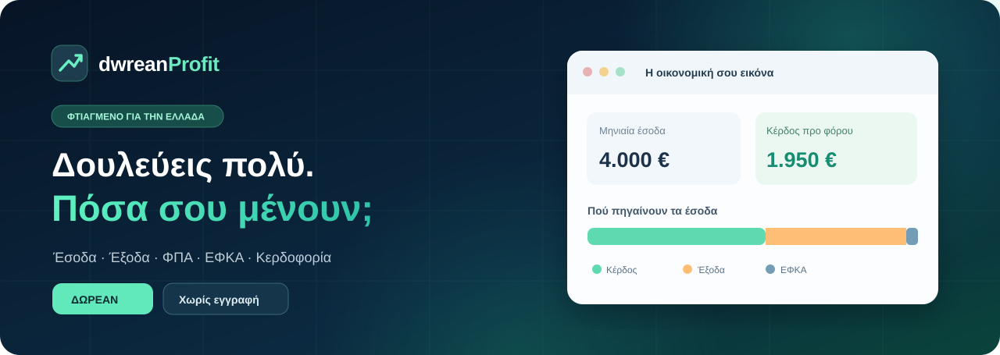

<div align="center">



<br>

[](#)
[](#)
[](#)
[](LICENSE)

### Δουλεύεις πολύ. **Πόσα σου μένουν;**

Ένας δωρεάν υπολογιστής κερδοφορίας στα ελληνικά, σχεδιασμένος για **ελεύθερους επαγγελματίες και ατομικές επιχειρήσεις** στην Ελλάδα.

**[Άνοιξε το dwrean Profit](https://dwrean-net.github.io/dwrean-Profit/)** · **[Οδηγός χρήσης](docs/USER-GUIDE.md)** · **[dwrean.net](https://www.dwrean.net/)**

<sub>Ο σύνδεσμος εφαρμογής λειτουργεί μόλις ενεργοποιηθεί το GitHub Pages στις ρυθμίσεις του repository.</sub>

</div>

---

## Τι είναι το dwrean Profit;

Αν εισπράττεις χρήματα από την εργασία σου, αλλά δεν ξέρεις ακριβώς τι σου μένει μετά τα έξοδα, τις εισφορές και την εκτιμώμενη φορολογία, το **dwrean Profit** προσφέρει μια άμεση, κατανοητή οικονομική εικόνα.

Δεν χρειάζεται εγκατάσταση, λογαριασμός ή συνδρομή. Γράφεις μερικά ποσά και βλέπεις το αποτέλεσμα.

| 📊 Η οικονομική εικόνα σου | 🎯 Πιο σωστή τιμολόγηση |
|:--|:--|
| Έσοδα με ή χωρίς ΦΠΑ | Πόσο χρειάζεται να χρεώνεις ανά ώρα |
| Μηνιαία λειτουργικά έξοδα | Πόσους πελάτες χρειάζεσαι για τον στόχο σου |
| Ασφαλιστικές εισφορές e-ΕΦΚΑ | Τι γίνεται αν αυξήσεις τον τζίρο |
| Κέρδος πριν από φόρο | Τι γίνεται αν μειώσεις τα έξοδα |
| Ενδεικτικός φόρος και προκαταβολή | Αναφορά PDF, δεδομένα CSV / JSON |

### Γιατί να το χρησιμοποιήσεις;

- **Φτιαγμένο για την Ελλάδα:** ελληνικοί συντελεστές ΦΠΑ, δυνατότητα εισαγωγής ΕΦΚΑ και ενδεικτική κλίμακα φορολογίας επιχειρηματικής δραστηριότητας για το **2026**.
- **Καθαρή εικόνα:** ξεχωρίζει τα έσοδα χωρίς ΦΠΑ, το λειτουργικό κόστος, τις εισφορές, το κέρδος και την ενδεχόμενη φορολογία.
- **Χωρίς εγγραφή:** υπολογισμοί μέσα στον browser, χωρίς αποστολή οικονομικών στοιχείων σε διακομιστή.
- **Παντού:** λειτουργεί σε υπολογιστή, tablet και κινητό.
- **Τα δεδομένα είναι δικά σου:** αποθήκευση στον browser και εξαγωγή ή εισαγωγή JSON.

## Πώς το χρησιμοποιείς

**1.** Συμπλήρωσε τον μηνιαίο τζίρο σου και δήλωσε αν περιλαμβάνει ΦΠΑ.  
**2.** Πρόσθεσε τα λειτουργικά έξοδα και τις ασφαλιστικές εισφορές σου.  
**3.** Δες το κέρδος και, όπου εφαρμόζεται, μια **ενδεικτική** φορολογική εκτίμηση.  
**4.** Πειραματίσου με σενάρια τζίρου και εξόδων ή βρες την ελάχιστη χρέωση για τον στόχο σου.  
**5.** Επίλεξε **Αποθήκευση PDF**, **CSV** ή **JSON** για να κρατήσεις την ανάλυσή σου.

> **Σημαντικό:** Τα αρχικά ποσά είναι **υποθετικά παραδείγματα**. Δεν αποτελούν πρότυπο φορολογικής δήλωσης ή πραγματικά οικονομικά στοιχεία.

➡️ [Διάβασε τον αναλυτικό οδηγό χρήσης](docs/USER-GUIDE.md)

## Γρήγορη εκκίνηση και GitHub Pages

Αυτή είναι μια στατική εφαρμογή HTML/CSS/JavaScript. **Δεν απαιτεί npm, build, API keys ή backend.**

Για χρήση στον υπολογιστή σου, κατέβασε το repository και άνοιξε το `index.html`. Εναλλακτικά, από τον φάκελο του project:

```bash
python -m http.server 8000
```

και άνοιξε `http://localhost:8000/`.

**Για δημοσίευση στο GitHub Pages:** πήγαινε στο **Settings → Pages → Build and deployment**, επίλεξε **Deploy from a branch**, branch **main**, folder **/(root)** και πάτησε **Save**. Μετά τη δημοσίευση, η εφαρμογή θα είναι διαθέσιμη στη διεύθυνση:

**https://dwrean-net.github.io/dwrean-Profit/**

## Τι περιλαμβάνει το repository

```text
dwrean-Profit/
├── index.html              # Η εφαρμογή
├── style.css               # Responsive εμφάνιση
├── js/
│   ├── calculations.js     # Υπολογισμοί
│   └── app.js              # Περιβάλλον χρήστη
├── assets/
│   ├── favicon.svg         # Εικονίδιο
│   └── cover.svg           # Εξώφυλλο GitHub
├── manifest.webmanifest
├── tests.js                # Αυτοματοποιημένοι έλεγχοι
├── docs/                   # Οδηγίες / μέθοδος / απόρρητο
├── LICENSE
└── README.md
```

Για τους ελέγχους, με εγκατεστημένο Node.js:

```bash
node --test tests.js
```

## Πόσο ακριβείς είναι οι υπολογισμοί;

Το εργαλείο προορίζεται **κυρίως για μία ατομική επιχειρηματική δραστηριότητα** με έναν επιλεγμένο συντελεστή ΦΠΑ πωλήσεων. Τα ποσά ανάγονται σε 12 ίδιους μήνες.

Η εκτίμηση φόρου **δεν είναι φορολογική εκκαθάριση** και δεν καλύπτει αυτομάτως ελάχιστο τεκμαρτό εισόδημα, εισόδημα από άλλες πηγές, ιδιαίτερες απαλλαγές, συμψηφισμούς, παρακρατήσεις, περιπτώσεις πολλαπλών συντελεστών ΦΠΑ, εταιρική φορολογία ή όλες τις ειδικές διατάξεις. Σε ορισμένες περιπτώσεις η εκτίμηση φόρου απενεργοποιείται.

**Δεν υποβάλλει στοιχεία στο myDATA ή στην ΑΑΔΕ και δεν αντικαθιστά τον λογιστή σου.** Μην το χρησιμοποιείς ως τη μοναδική βάση για φορολογικές ή επιχειρηματικές αποφάσεις.

📖 [Αναλυτικά: μεθοδολογία, παραδοχές και περιορισμοί](docs/METHODOLOGY.md)

## Ιδιωτικότητα

Τα δεδομένα που συμπληρώνεις υπολογίζονται στον browser και αποθηκεύονται **τοπικά στη συσκευή σου** για να τα βρίσκεις την επόμενη φορά. Δεν δημιουργείται λογαριασμός και δεν υπάρχει server που δέχεται τα οικονομικά σου στοιχεία. Τα τοπικά δεδομένα ενδέχεται να παραμένουν διαθέσιμα σε όποιον χρησιμοποιεί το ίδιο προφίλ browser. Μπορείς να τα διαγράψεις από το περιβάλλον της εφαρμογής ή από τις ρυθμίσεις του browser.

🔒 [Περισσότερα για την ιδιωτικότητα](docs/PRIVACY.md)

## Επίσημες πηγές και ενημέρωση

Οι παραδοχές της έκδοσης 1.0 έχουν ως έτος αναφοράς το **2026** (έλεγχος 09/11/2026). Η ελληνική φορολογική νομοθεσία μπορεί να αλλάξει.

- [Υπουργείο Εθνικής Οικονομίας και Οικονομικών – φορολογία εισοδήματος](https://minfin.gov.gr/forologiki-politiki/forologikos-odigos/forologia-eisodimatos/)
- [ΑΑΔΕ – βασικοί συντελεστές ΦΠΑ](https://www.aade.gr/exypiretisi-enimerosi/hristikoi-odigoi/enarxi-epiheirimatikis-drastiriotitas/basikoi-syntelestes-fpa)
- [e-ΕΦΚΑ – ασφαλιστικές εισφορές μη μισθωτών](https://www.e-efka.gov.gr/el/asphalismenoi/me-misthotoi/neo-systhma-asfalistikon-eisforon/neoi-epaggelmaties)
- [ΑΑΔΕ – προκαταβολή φόρου από επιχειρηματική δραστηριότητα](https://www.aade.gr/exypiretisi-enimerosi/hristikoi-odigoi/enarxi-epiheirimatikis-drastiriotitas/prokataboli-foroy-eisodimatos-apo-epiheirimatiki)

## Προτάσεις και αναφορές προβλημάτων

Βρήκες λάθος ή έχεις ιδέα για νέα λειτουργία; Άνοιξε ένα [Issue](https://github.com/dwrean-net/dwrean-Profit/issues) με σαφή περιγραφή και, αν χρειάζεται, ένα παράδειγμα με **φανταστικά ποσά** — όχι πραγματικά προσωπικά ή οικονομικά δεδομένα.

Δες επίσης το [CONTRIBUTING.md](CONTRIBUTING.md).

## Άδεια και δημιουργός

Ο κώδικας διατίθεται με άδεια [MIT](LICENSE).

**Δημιουργία: [dwrean.net](https://www.dwrean.net/)** — δωρεάν εφαρμογές και χρήσιμα εργαλεία για όλους.

<div align="center"><sub>dwrean Profit · Δωρεάν · Ελληνικό · Χωρίς συνδρομές</sub></div>
